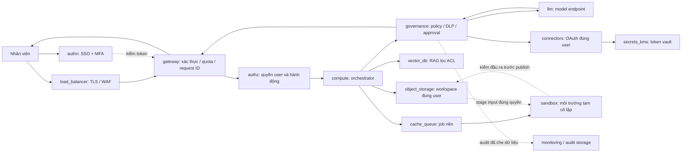

# Thiết kế bảo mật, sandbox và governance

Trạng thái: đề xuất. Các yêu cầu H1–H5 lấy từ đề; thông số chưa có trong đề được ghi là đề xuất/chờ xác nhận. Thiết kế độc lập nhà cung cấp để ghép sau khi Dũng/Bảo chốt cloud.

## 1. Ranh giới và luồng request

Các mũi tên stage/publish của sandbox do runner bên ngoài thực hiện. Sandbox không tự có quyền truy cập object storage hay vault. Gateway/compute thực thi quyền; model không quyết định quyền của chính nó. Các đường gọi nội bộ phải có danh tính dịch vụ và quyền tối thiểu.

## 2. SSO, ACL và token vault

1. User đăng nhập SSO tập đoàn bằng OIDC hoặc SAML, MFA theo chính sách IdP. Gateway kiểm issuer/audience, chữ ký, thời hạn và trạng thái phiên; nếu dùng SAML thì backend đổi thành phiên ứng dụng, không xử lý assertion như JWT.
2. Backend lấy `tenant_id`, `user_id` từ phiên đã xác thực, không tin trường user/tenant trong prompt hoặc request body. RBAC giới hạn chức năng; ABAC/ACL giới hạn tài nguyên.
3. Khi liên kết connector, dùng OAuth authorization code + PKCE nếu provider hỗ trợ; kiểm `state`, redirect URI chính xác và consent scope tối thiểu. Phong cung cấp scope theo từng thao tác đọc/ghi; không cấp service account đọc toàn tập đoàn.
4. Refresh/access token được mã hóa bằng khóa KMS, tách theo tenant/user/provider. Chỉ connector broker cần thiết được giải mã. Model, sandbox, trình duyệt và log không nhận token connector. Áp dụng rotation/revocation theo khả năng provider, xử lý hết hạn/thu hồi bằng yêu cầu đăng nhập lại.
5. Mọi truy vấn RAG đưa điều kiện tenant/user/group ACL vào bước truy xuất. Kiểm quyền lại trước khi đưa tài liệu vào context hoặc tải file. Đồng bộ ACL và xử lý thu hồi quyền; nếu ACL quá cũ hoặc không xác minh được thì từ chối tài liệu đó. Phong cần chốt cửa sổ độ tươi và phương pháp kiểm quyền gốc.
6. Cache key phải chứa phạm vi quyền và phiên bản ACL; không dùng cache kết quả chứa dữ liệu riêng giữa các user. Khi quyền bị thu hồi phải vô hiệu hóa cache liên quan.
7. Object key là cách tổ chức, không phải biện pháp phân quyền duy nhất. Mọi đọc/ghi workspace kiểm user tại API và storage policy; link tải nếu dùng phải ngắn hạn, giới hạn đúng object. Memory hội thoại áp dụng cùng ranh giới quyền.

## 3. Sandbox

Ứng viên ban đầu: runtime gVisor trên pool worker riêng; quyết định cuối phụ thuộc cloud, khả năng tương thích thư viện và chi phí. Nếu chọn microVM/Kata/Firecracker cần cập nhật cơ chế tương đương và overhead. Không coi container thường hoặc namespace đơn lẻ là đủ để xử lý code không tin cậy.

| Kiểm soát | Thiết kế đề xuất |
| --- | --- |
| Danh tính job | Runner tạo job ID gắn tenant/user, snapshot input đã kiểm quyền và hạn mức; không lấy owner từ code |
| Vòng đời | Cấp môi trường mới → stage input → chạy → kiểm output → publish → hủy cả môi trường và volume tạm |
| Mount | Chỉ bản sao input được phép; root filesystem read-only, vùng ghi tạm có quota; không mount host path, Docker socket hoặc credential |
| Quyền OS | Non-root, không privileged, bỏ capability không cần thiết, không host network/PID/IPC, không privilege escalation |
| Mạng | Mặc định chặn ingress/egress kể cả DNS; chặn metadata IPv4/IPv6, mạng nội bộ và control plane; cài thư viện sẵn trong image |
| Credentials | Không token connector/cloud; tắt tự mount service-account token; quyền của worker/runner cũng phải hạn chế |
| Tài nguyên | Giới hạn CPU, RAM, PID, dung lượng/size output, wall-time và số phiên/user; số cụ thể nhận từ Kiệt |
| Tác vụ bên ngoài | Code trả kết quả có cấu trúc; orchestrator gọi connector qua policy/approval, không mở mạng cho code gửi email |
| Output | Kiểm loại file, kích thước, path traversal, symlink và DLP; archive cần giới hạn giải nén; chỉ publish vào workspace chủ job |
| Dọn dẹp | Có tác vụ thu gom job treo sau crash; xác nhận xóa volume tạm, không tái dùng workspace bẩn cho user khác |

NetworkPolicy cần CNI thực thi và không thay thế runtime isolation hay chặn mạng ở host/cloud. Không đặt sandbox trên host network. Kiểm chứng đường metadata và IPv6 riêng trước khi tuyên bố chặn egress đạt.

## 4. Approval và prompt injection

Nội dung connector, tài liệu, email và output code là dữ liệu không tin cậy. Giữ nguồn/provenance, tách khỏi chỉ dẫn hệ thống; không cho chúng sửa policy hoặc cấp thêm tool. Guardrail giúp phát hiện nhưng không bảo đảm loại bỏ mọi prompt injection; quyền và approval phải được thực thi bên ngoài model.

Luồng ghi: `model đề xuất → policy/ACL/DLP → user xem trước → user xác nhận → kiểm lại quyền/payload → connector thực thi → audit + thông báo`.

- Bản xem trước phải có tài khoản nguồn, người nhận/đích, nội dung, attachment và phạm vi thay đổi/xóa.
- Approval gắn tenant/user, action, đích và hash payload; có hạn dùng và dùng một lần. Đổi payload/đích thì xin xác nhận mới.
- Retry dùng idempotency key hoặc đối soát trạng thái provider để tránh gửi email/tạo ticket trùng. Không tự chạy lại tác vụ ghi chưa rõ kết quả.
- Không cho nội dung email hoặc kết quả model tự tạo approval. Khi policy deny, user approval không tự vượt deny.
- Hành động bị từ chối/thất bại trả trạng thái rõ, không nói đã gửi khi connector chưa xác nhận.

## 5. Data governance

| Dữ liệu | Chính sách đề xuất, chờ nhóm duyệt |
| --- | --- |
| In transit / at rest | TLS trên luồng ngoài và nội bộ; mã hóa database/object/backup/vault; phân quyền khóa, audit giải mã và kế hoạch rotation |
| Phân loại | Public / Internal / Confidential / Restricted; Restricted mặc định không đưa ra model bên ngoài nếu chưa có chính sách cho phép |
| PII/secrets | DLP trước model, trước connector ghi và trước publish output; che/tokenize dữ liệu không cần thiết, chặn secret; đo cả false positive và false negative |
| Audit | Bắt buộc 12 tháng: actor, tenant, request/job ID, action, resource ID, policy/approval ID, outcome, thời gian; phân quyền ghi/đọc riêng, chống sửa/xóa bằng tính năng storage được chọn |
| Chat/memory | Đề xuất 90 ngày cho chat; memory có mục đích và cơ chế xóa. Nhóm/đơn vị dữ liệu phải duyệt thời hạn chính thức |
| Workspace | Quota theo đề 10 GB/user; không hiểu quota bằng dung lượng thực đã dùng; chính sách xóa và backup cần thống nhất với Phong |
| Sandbox | Xóa dữ liệu tạm khi xong; chỉ giữ artifact user chọn và metadata audit |
| Log vận hành | Đề xuất hot 30 ngày; log audit lưu riêng đủ 12 tháng. Không log raw prompt/document, authorization header hoặc refresh token mặc định |
| Nhà cung cấp model | Xác minh điều khoản không huấn luyện trên dữ liệu; nếu gọi API bên ngoài còn cần private endpoint hoặc cam kết không lưu dữ liệu theo H1. Hai điều kiện phải kiểm riêng |

Xóa dữ liệu phải nêu cả index/cache/replica và thời hạn hết vòng đời backup; không hứa xóa tức thì khỏi backup bất biến. Quyền đọc audit không đồng nghĩa quyền đọc nội dung tài liệu gốc.

## 6. Eval gate

Kiệt sở hữu bộ eval 5 cấp và model tham chiếu. Trước đổi model/prompt/tool/policy: chạy tập chất lượng (từng cấp ≥95% điểm model tham chiếu), tập bảo mật và đo độ trễ/chi phí; lưu phiên bản cấu hình, kết quả và người duyệt. Không qua thì giữ phiên bản cũ; rollout có kiểm soát và rollback được. Bộ kiểm thử bảo mật xem tài liệu vận hành.

## Nguồn kỹ thuật đối chiếu

- [gVisor security architecture](https://gvisor.dev/docs/architecture_guide/intro/): nền tảng đánh giá runtime; runtime không thay toàn bộ kiểm soát hệ thống.
- [Kubernetes multi-tenancy](https://kubernetes.io/docs/concepts/security/multi-tenancy/): phân tách workload và tài nguyên.
- [Kubernetes NetworkPolicy](https://kubernetes.io/docs/concepts/services-networking/network-policies/): điều kiện thực thi và giới hạn chính sách mạng.
- [OAuth Security BCP — RFC 9700](https://www.rfc-editor.org/rfc/rfc9700.html): đối chiếu authorization flow và bảo vệ token theo khả năng provider.

Các nguồn trên hỗ trợ cơ chế, không chứng minh thiết kế VBot đã được kiểm thử hay cung cấp bằng chứng giá.
