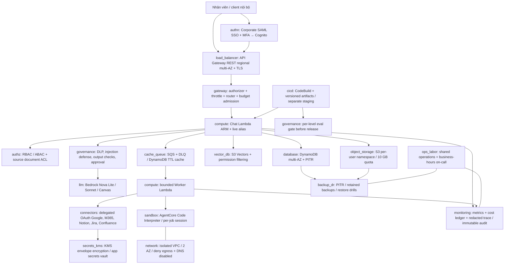

# VBot Workplace trên AWS — Eviaura

> Cập nhật 16/10/2026: báo giá hiện tại chuyển sang `ap-southeast-1`, tổng **6.022,78 USD/tháng**. Các quyết định US trong tài liệu này là kiến trúc tham chiếu ban đầu. Xem [bổ sung Singapore, model routing và EOL](REGION_SINGAPORE.md) trước khi dùng báo giá hoặc triển khai.

Thiết kế cho 2.000 DAU theo `vbot-capstone.html`, ngày lập 16/10/2026. Chọn **serverless + Bedrock trả theo sử dụng**, production và staging riêng. Mục tiêu là giảm chi phí trong các phương án đáp ứng H1–H8; chưa có benchmark để tuyên bố đây là phương án rẻ nhất hợp lệ.

Phạm vi đã làm: kiến trúc, dự toán có thể tái tạo, XLSX đúng cấu trúc đề, CloudFormation mục tiêu và bộ kiểm tra cục bộ. Repo ban đầu chỉ có đề bài; **chưa có ứng dụng VBot**, OAuth registrations, corpus hay tập eval. Template nhận ZIP ứng dụng đã review từ S3, không thay thế phần phát triển ứng dụng. Chưa tạo tài nguyên AWS hoặc gọi model tính phí.

## Lựa chọn chính

| Quyết định | Lý do và điều kiện |
|---|---|
| `us-east-1`, model US geographic inference | Region có nhiều dịch vụ/model và đầu vào giá thuận lợi. Phải được doanh nghiệp cho phép lưu dữ liệu tại Mỹ; đo p95 từ Việt Nam trước khi chốt. Nếu cần APAC, tính lại toàn bộ SKU và model availability, không chỉ đổi region template. |
| API Gateway **REST** regional → Lambda ARM | Managed HA và TLS, không thêm ALB/EC2/EKS. REST hỗ trợ response streaming; HTTP API không dùng cho đường SSE này. |
| DynamoDB on-demand | Truy cập đã xác định theo tenant/user/job/doc ID; không cần JOIN. Chat metadata, memory references, ACL, token ciphertext, approvals và quota dùng cùng engine, khác namespace. |
| S3 + S3 Vectors | File lớn nằm ở S3; vector trả theo sử dụng, tránh compute tìm kiếm chạy liên tục. Retrieval tự viết để kiểm soát ACL, không crawler bằng service account toàn doanh nghiệp. |
| Bedrock Nova Lite và Sonnet 4.5 | Tác vụ đơn giản dùng Lite sau khi eval; code/agent dùng Sonnet; escalation 10% là giả định chi phí, không phải kết quả đo. |
| AgentCore Code Interpreter **VPC** | Session riêng cho mỗi job, subnet cô lập; không NAT, IGW, endpoints hoặc DNS; không cấp execution role truy cập dữ liệu. `SANDBOX` vẫn có quyền truy cập S3 theo tài liệu AWS nên không đủ cho yêu cầu mặc định không egress. |
| Không dùng GPU riêng, Redis, NAT Gateway hoặc Kubernetes | Tải trung bình thấp, ưu tiên giảm chi phí cố định và vận hành. Chỉ xét GPU sau benchmark throughput, chất lượng và tổng HA + đội vận hành. |

Nguồn kỹ thuật: [REST streaming](https://docs.aws.amazon.com/apigateway/latest/developerguide/response-transfer-mode.html), [S3 Vectors](https://docs.aws.amazon.com/AmazonS3/latest/userguide/s3-vectors.html), [Code Interpreter network modes](https://docs.aws.amazon.com/bedrock-agentcore/latest/devguide/code-interpreter-resource-management.html), [Bedrock data protection](https://docs.aws.amazon.com/bedrock/latest/userguide/data-protection.html). AWS Bedrock không dùng prompt/completion để huấn luyện base models; trước release vẫn phải xác minh chính sách lưu trữ và điều khoản của model cụ thể. Không gửi dữ liệu ra API model ngoài AWS trong phương án này.

## Sơ đồ và 19 component

`embedding` là component bổ sung: Titan Embeddings V2, dimension 1024; 120M token/tháng gồm incremental indexing và query embedding. Một triệu chunk × 500 token cần 500M token index ban đầu; phí một lần tính riêng trong dự toán. Không mặc định embed toàn bộ 20 TB workspace; chỉ tài liệu được user yêu cầu index và có ACL. Nếu lượng corpus thực tế lớn hơn 1M chunk, phải tăng cả embedding, vector ingestion và query scan.

## Tải và sizing

| Driver | Giả định / công thức |
|---|---|
| Tác vụ | 2.000 × 8/ngày × 22 ngày = 352.000 tác vụ/tháng |
| L1 / L2 / L3 / L4 / L5 | 60% / 20% / 10% / 9% / 1% |
| Input/output tokens mỗi tác vụ | L1 2.000/400; L2 4.000/900; L3 6.000/1.500; L4 9.000/1.600; L5 2.000/300. Là tổng token qua các lượt tool/model, không chỉ user prompt. |
| Lưu lượng | 352.000 / (220 × 3.600), peak factor 6. Cụ thể xem `deliverables/cost-model.json`. |
| Sessions | Mean chat request 20 giây; peak concurrency = peak RPS × 20. Lambda reserved concurrency 100; 10 warm slots trong giờ hành chính, overflow on-demand. Warm slots không thay thế khả năng scale. |
| Bedrock quota | Peak input/output TPM từ script; cộng escalation, retry, staging và ít nhất 30% headroom theo từng model/profile. Quota thực tế là deployment gate. |
| Sandbox | 10% request = 35.200 session/tháng; 120 giây/session; dự toán 1 active vCPU và 4 GB memory, không khấu trừ idle CPU. Cấp tài nguyên thực tế của dịch vụ phải đo lại. |
| Image | 3.520 ảnh/tháng, Nova Canvas 1024 standard; 5% retries và 5% staging. Sơ đồ xác định được có thể render từ code để giảm lượt sinh ảnh; không trừ khoản này trước khi đo. |
| File | Báo giá chính dùng đủ 2.000 × 10 GB = 20.000 GB, thêm KB 200 GB và staging 100 GB; version backup thêm 4.000 GB. |
| Chat / memory / state | DynamoDB 50 GB gồm staging; chat text dài đưa vào S3, DynamoDB giữ chỉ mục và references. Không vượt giới hạn item. Retention chat 90 ngày theo policy doanh nghiệp. |
| Audit / logs | 20 GB operational logs mới/tháng; hot 30 ngày. Audit redacted 20 GB/tháng × 12 tháng = 240 GB S3 Object Lock; mỗi event chỉ metadata và digest. |
| Connector / network | 1M connector calls và 300 GB internet outbound/tháng; cần đối chiếu API pagination, refresh, artifact downloads và model streams. Thay đổi mix có thể làm sai envelope. |
| Staging | Stack và data riêng; model/chat/sandbox 5% prod; 100 MAU; không warm capacity. Production hoạt động 24/7, warm capacity theo lịch 220 giờ, cộng thời gian warm-up. |

## Request, dữ liệu và hành động ghi

1. Client dùng authorization code + PKCE S256 qua SAML federation. MFA nằm tại IdP; không coi MFA của Cognito local user là bằng chứng IdP đã MFA. API yêu cầu access token với scope `vbot/chat`.
2. Gateway xác thực token. Backend lấy tenant/user ổn định từ subject đã xác minh và mapping nội bộ; bỏ qua tenant/user mà request body tự khai báo. Dùng RBAC cho quyền gọi tool và ABAC cho resource.
3. Trước mỗi model/tool call, reserve chi phí tối đa bằng transaction: counter user, phòng ban, toàn hệ thống và request idempotency. Không đủ ngân sách thì từ chối trước khi gọi; reconcile theo usage thật sau đó. Không double-spend khi retry. Timeout chưa có usage giữ reservation đến khi reconcile, không hoàn ngay.
4. Input được phân loại, che PII theo policy, loại secrets; tài liệu/email luôn là dữ liệu không tin cậy. Retrieval lọc tenant/principal tại query và kiểm tra lại ACL ở nguồn trước khi nội dung vào prompt. Nếu ACL cũ, nguồn lỗi hoặc quyền đã thu hồi: fail closed. Metadata filter đơn thuần không chứng minh an toàn ACL.
5. L1/L2/L5 dùng Nova Lite chỉ khi từng cấp đạt ít nhất 95% điểm baseline; L3/L4 dùng Sonnet. Không dùng một điểm trung bình chung cho cả 5 cấp. Escalation là fallback chất lượng có budget reservation riêng. Model confidence tự báo không phải phép đo chất lượng.
6. Streaming qua REST AWS proxy `ResponseTransferMode=STREAM`. Kiểm tra output theo buffer trước khi gửi từng phần; token/chunk đầu không được bỏ qua DLP. Citation và tool output kiểm tra độc lập. Request dài chuyển background job; trả job ID và phát thông báo/poll trạng thái.
7. Sandbox mới theo job, giới hạn thời gian tối đa 600 giây, kiểm tra kích thước file/process và CPU/memory theo khả năng dịch vụ. Controller truyền file đã authorize qua tools; không mount workspace toàn user, không đưa refresh token/AWS task role vào session. `finally` luôn stop session; watchdog dừng session mồ côi. Test HTTP, IPv6, DNS, S3 và private-IP egress trước nghiệm thu.
8. Với gửi mail, tạo/sửa ticket/page hoặc xóa file: tạo proposal gồm user, action, provider, target ID, scope, payload digest và expiry. User xem đúng diff rồi xác nhận. Worker kiểm tra lại ACL, proposal digest, nonce một lần, expiry và token user trước khi gọi API. Prompt hoặc tool response không thể tự tạo approval.
9. Connector OAuth dùng quyền delegated thấp nhất theo từng chức năng; tách read và write consent. Refresh token mã hóa envelope KMS trong token vault DynamoDB. OAuth client secrets dùng Secrets Manager. Không dùng tài khoản đọc toàn tenant; xử lý refresh/revoke, provider 429 và pagination bằng retry hữu hạn, idempotency.
10. Audit append-only gồm actor, action, object digest, approval ID, model version, token/cost, latency và verdict. Không lưu raw token/prompt/document vào logs hay queue. S3 prefix không tự tạo tenant isolation: chỉ trusted controller được truy cập, mọi URL ký phải kiểm tra owner, TTL ngắn và quota byte bằng atomic reservation.

Cache mặc định **không tính tiết kiệm**. Khi có thể bật, key phải chứa tenant, user/principal, ACL version, prompt/model version và nguồn. Không share semantic cache giữa user; TTL kiểm tra ở ứng dụng vì DynamoDB TTL xóa bất đồng bộ.

## HA, backup và DR

API Gateway, Lambda và DynamoDB là managed multi-AZ; không đặt một EC2 gateway hoặc single-AZ DB ở giữa. Worker stateless, SQS + DLQ giữ job; retry hữu hạn và idempotent. Sự cố AZ của sandbox tạo session mới ở AZ khác từ checkpoint/file đã lưu, không reuse session người khác.

Mục tiêu 99,5% giờ hành chính, RTO ≤4h, RPO ≤1h. Với mất dữ liệu logic/sự cố dịch vụ **trong cùng region**, dùng PITR cho DynamoDB, S3 versioning và immutable audit; backup định kỳ và tách quyền backup khỏi application writer. Vector rebuild từ snapshot chunk/embedding lưu S3, không bắt buộc gọi embed lại. Mỗi tháng restore vào table/bucket mới, chạy checksum, ACL và replay idempotency, ghi thời gian và tuổi bản ghi cuối. Các chỉ tiêu này **chưa đo**.

Phương án giá chính chưa bao gồm active standby/copy toàn bộ 20 TB sang region khác. Vì vậy **không cam kết RTO/RPO khi cả region ngừng hoạt động**. Nếu hội đồng yêu cầu regional DR, phải thêm replication object + state liên vùng, khóa/bản sao token vault, copy artifact và IaC, kiểm thử failover, rồi báo giá lại; không gọi backup cùng region là regional DR.

## Cổng H1–H8 và nghiệm thu

| Cổng | Thiết kế kiểm soát | Bằng chứng còn cần |
|---|---|---|
| H1 | AWS primary us-east-1, AWS-native Bedrock, TLS, US inference boundary | Duyệt residency, model lifecycle/access và chính sách lưu trữ cụ thể |
| H2 | SAML/MFA, access scopes, RBAC/ABAC, live ACL, encrypted token vault | Tenant thực, revoked ACL/OAuth tests, IdP MFA evidence |
| H3 | Identity-derived keys, private file broker, VPC isolated interpreter per job | Cross-user probes, egress/DNS tests, resource limits và cleanup |
| H4 | Input/output DLP, document trust boundary, explicit approvals, eval gate | Injection suite; no-write-before-confirmation; stale/replayed approval tests |
| H5 | TLS/SSE, KMS vault, retention, immutable 366-day audit | DLP coverage, deletion/retention policy và key recovery audit |
| H6 | Streaming, bounded context, warm schedule, background deadline ≤600s | Load từ VN ở peak, cold/overflow/throttle cases; p95 first **model** token ≤3s; không dùng heartbeat để tính TTFT |
| H7 | Multi-AZ managed path, PITR/versions, restore runbook | Failover + restore drill cho RTO/RPO; xác nhận phạm vi regional DR với giảng viên |
| H8 | Baseline Sonnet 4.5 cho text và Canvas cho ảnh; per-level score ≥95%; atomic quota + budget alerts | Tập ít nhất 50 ca/cấp do người review, output/cost thực; baseline và candidate cùng dữ liệu, prompt, policy |

Trạng thái hiện tại là **thiết kế chờ nghiệm thu**, không phải 8/8 đã pass. Giá chỉ được xem là hợp lệ cho thi đấu khi các cổng có bằng chứng. Eval gate cục bộ trong `scripts/eval_gate.py` chỉ kiểm tra kết quả được cung cấp; không tự sinh điểm hoặc chứng minh an toàn.

## Chi phí và thứ tự tối ưu

Tổng xem [báo giá](../deliverables/BAOGIA.md); nguồn và công thức từng dòng trong [XLSX](../deliverables/Eviaura_baogia.xlsx). So sánh là dự toán dưới cùng workload, không phải savings thực đo. Không dùng trial, credits, chiết khấu đàm phán hay commit dài hạn.

1. Đo tokens theo từng tool turn, cắt retrieved context và chỉ giữ conversation summary có kiểm chứng. Đây là đòn bẩy chính vì Sonnet chiếm phần lớn chi phí; không giảm DAU hoặc âm thầm giảm workload để làm đẹp giá.
2. Chuyển từng nhóm tác vụ từ Sonnet sang model nhỏ khi **nhóm đó** pass H8, giữ fallback và tính cả call rẻ bị bỏ. Không dùng routing 100% Nova trước eval.
3. Index tài liệu có nhu cầu, deduplicate theo content+ACL; không nhân bản tài liệu chung theo 2.000 user. Cache theo quyền sau khi đo hit rate.
4. Quota 10 GB không đồng nghĩa đã dùng 10 GB. Giá chính vẫn trả đủ quota; kịch bản 1 GB/người chỉ là sensitivity. Version retention/lifecycle phải tôn trọng restore và retention, không đổi sang One Zone để giảm giá HA.
5. Staging không warm, giới hạn model budget thấp, dữ liệu synthetic. Không chạy GPU/NAT/Kubernetes/Redis liên tục cho tải này.
6. 4.000 DAU cần tăng model quota, concurrency, sandbox sessions và storage; dự toán envelope trong JSON tăng tuyến tính biến phí và nâng labor lên 0,15 FTE. Phải kiểm tra lại p95, không suy ra HA/chất lượng từ phép nhân đôi.

Công vận hành là giả định 0,10 FTE × 2.000 USD/FTE-tháng; không phải giá thuê đội trực riêng. License Google/M365/Notion/Jira có sẵn do doanh nghiệp cấp, không mua thêm seat trong phương án; nếu chưa có phải thêm `licenses`. Dự toán chưa VAT, chưa premium support và chưa phí one-time phát triển, onboarding OAuth hay eval ban đầu. Không giấu các khoản này dưới chi phí bằng 0.
