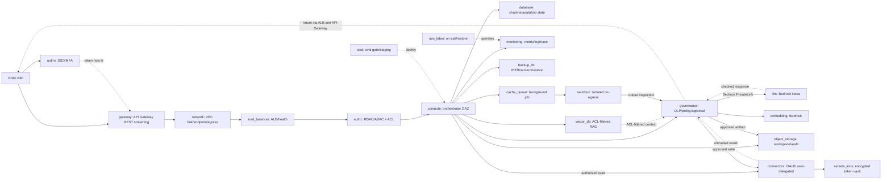
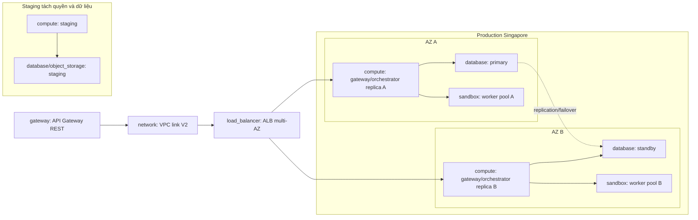

# D3 — kiến trúc tổng và một request

Trạng thái: sơ đồ logic để Bảo chốt AWS SKU/HA và Phong chốt data path; **chưa chứng minh H1–H8 bằng chạy thử**. Dũng chọn AWS `ap-southeast-1` làm region làm việc; Bảo còn phải xác nhận SKU và topology. Production hai AZ, staging tách riêng. Text model dùng Bedrock APAC geo cross-region theo [Kiệt](../kiet/KIET_MODEL_SERVING.md), nên vị trí suy luận có thể nằm ở region APAC khác. Cấp 5 mặc định xuất SVG/HTML qua model text; chưa bật bitmap ngoài APAC.

Sơ đồ có **19/19 mã bắt buộc**: `compute`, `llm`, `gateway`, `load_balancer`, `authn`, `authz`, `database`, `vector_db`, `object_storage`, `cache_queue`, `sandbox`, `connectors`, `secrets_kms`, `backup_dr`, `monitoring`, `governance`, `network`, `cicd`, `ops_labor`. `embedding` là mã tùy chọn có giá riêng của Kiệt.

Topology triển khai để Bảo gắn SKU và số node:

Staging chạy bao nhiêu giờ và có replica hay không phải ghi rõ trong dòng giá; sơ đồ này không mặc định staging có HA production. Sau mất một AZ, AZ còn lại cần đủ năng lực peak hoặc policy giảm tải đã được nhóm duyệt và thử.

## Một request đọc tài liệu, rồi đề xuất cập nhật Jira

1. User hoàn tất SSO/MFA; API Gateway REST dùng HTTP proxy response streaming, nhận TLS và qua VPC link V2 đến ALB, rồi app gateway/orchestrator ở hai AZ. Backend xác thực session, quota, `tenant_id/user_id` từ token và tạo request ID; `authz` kiểm vai trò/hành động. [AWS mô tả private integration REST qua VPC link V2 đến ALB](https://docs.aws.amazon.com/apigateway/latest/developerguide/private-integration.html) và [giới hạn response streaming](https://docs.aws.amazon.com/apigateway/latest/developerguide/response-transfer-mode.html).
2. Orchestrator truy vấn `vector_db` bằng bộ lọc ACL, kiểm lại quyền ở nguồn trước khi lấy nội dung từ `object_storage`/connector. Cache key gắn user/tenant và phiên bản ACL; không xác minh được quyền thì bỏ tài liệu.
3. `governance` lọc PII/secret, phân loại dữ liệu và tách nội dung tài liệu không tin cậy khỏi instruction. Gateway chọn Nova Micro/Pro theo cấp đã qua eval. VPC interface endpoint đưa lời gọi đến Bedrock; [AWS mô tả đường PrivateLink](https://docs.aws.amazon.com/bedrock/latest/userguide/vpc-interface-endpoints.html). APAC cross-region vẫn phải duyệt residency.
4. Nếu tác vụ cần code, `cache_queue` giao job cho `sandbox` riêng: stage bản sao input đã duyệt; chặn egress/DNS/metadata, giới hạn tài nguyên; kiểm artifact rồi mới publish; hủy môi trường tạm.
5. Model chỉ đề xuất thay đổi Jira. `governance`/`authz` kiểm lại scope, đích và payload; user xem và xác nhận đúng nội dung. Connector broker lấy OAuth token đúng user qua `secrets_kms`, thực hiện idempotent và ghi audit. Model/sandbox không nhận token.
6. Kết quả trở lại qua ALB, API Gateway rồi user. `monitoring` ghi metric/trace/audit đã che dữ liệu; `database`, `object_storage` và `backup_dr` giữ trạng thái theo chính sách retention/RPO.

## Chủ sở hữu và ranh giới giá

| Chủ | Component | Ranh giới chống tính trùng |
| --- | --- | --- |
| Dũng | `ops_labor` | Chỉ công trực vận hành và diễn tập; không cộng `licenses` khi `authn` đã chứa license |
| Kiệt | `llm`, `gateway`, `embedding` | LLM token, API request, embedding token; hosting app gateway nằm trong `compute` của Bảo |
| Phong | `connectors`, `database`, `vector_db`, `object_storage`, `cache_queue` | DB replica/PITR, data GB/call; phân biệt backup và log archive |
| Bảo | `sandbox`, `authn`, `authz`, `secrets_kms`, `governance`, `compute`, `load_balancer`, `network`, `backup_dr`, `monitoring`, `cicd` | Hai AZ/staging, runtime worker, endpoint/NAT/egress, log/backup; ghi nơi phí đã bao gồm |

HA yêu cầu LB managed, gateway/orchestrator ít nhất hai replica qua hai AZ, database failover, queue bền, sandbox pool riêng. RTO 4 giờ/RPO 1 giờ là mục tiêu phải đo bằng restore drill; availability ≥99,5% giờ hành chính có error budget **66 phút/tháng**. [Bảo mô tả ca kiểm chứng](../bao/OPERATIONS_AND_ACCEPTANCE.md).
